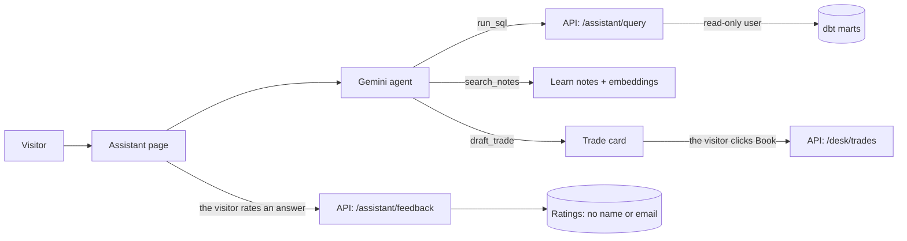

# Capital Markets Analytics


[](https://capital-markets-analytics.streamlit.app)

An end-to-end capital markets data platform: simulated market data, a 60-trade book valued every day
(P&L, DV01), a tested data pipeline (PostgreSQL, dbt, CI/CD), a REST API, a live app where visitors
book their own trades, and an AI assistant (LangChain + Google Gemini) that answers questions from the
live data.

- **Live app:** [capital-markets-analytics.streamlit.app](https://capital-markets-analytics.streamlit.app)
- **API docs:** [capital-markets-api.onrender.com/docs](https://capital-markets-api.onrender.com/docs)
  (free hosting: the first request can take up to a minute while the API wakes up)

All market data is synthetic, generated with a fixed seed. I built this project to learn how capital
markets work, and to practise the skills a test or data engineer uses on a trading platform.

## What the app shows

| Page | What you can do |
|---|---|
| **Market** | Equity indices, the yield curve on any date in 2025, FX rates and the 10y − 2y spread |
| **Portfolio** | P&L by desk over time, positions, and rate risk (DV01) by bond |
| **Pricing** | Price a bond or an FX forward yourself, and see the price–yield curve |
| **Trade desk** | Book, change and delete your own trades, priced at any 2025 market, and see each trade's XML message |
| **Learn** | The trading basics behind each page, with short quizzes |
| **Assistant** | Ask in plain English: an AI agent reads the live data with SQL, explains concepts from the Learn notes, and drafts trades that only you can book |

Visitors can trade as guests (their trades are cleared every morning) or **sign in with Google** to keep them.

## Architecture

```
generate_data.py ─► trades.py ─► valuation.py ─► load_db.py ─► PostgreSQL (Neon) ─► dbt
 market data         60 trades     7,403 daily      raw tables     cloud database     staging → intermediate → marts
                                   valuations       + run log
                                                                                        │
     Streamlit app (Streamlit Cloud)  ◄──────  REST API (FastAPI on Render)  ◄──────────┘
     8 pages, Google sign-in,                  18 endpoints, XML trade messages,
     AI assistant (Gemini)                     read-only SQL for the assistant
```

Data flows in one direction: the pipeline loads the database, dbt builds the tested marts, the API serves
them, and the app only talks to the API.

## Key numbers

| | |
|---|---|
| Trade book | 60 trades on 3 desks (Equity, Rates, FX), valued every trading day: 7,403 valuations |
| Python tests | 263 (unit, data, database, API, XML, page and regression tests), 48 of them for the AI assistant |
| AI evaluation | 16 questions asked to the real Gemini, each answer checked against the database: 16/16; median answer time 2.2 s |
| dbt | 9 models in 3 layers, 34 tests |
| API | 18 endpoints, documented with OpenAPI |

## How it is tested and deployed

- **Every pull request** runs in GitHub Actions: a fresh PostgreSQL container is loaded, `dbt build` runs
  the models and their tests, then all Python tests run. The `main` branch is protected: a pull request
  and green tests are required to merge.
- **Merging to `main`** redeploys the API (Render) and the app (Streamlit Community Cloud).
- **Every weekday morning** a scheduled workflow refreshes the cloud database: it runs the pipeline,
  rebuilds the dbt models, clears the guest trades and smoke-tests the live API. Each load is logged,
  and the Portfolio page shows when the data was last refreshed and by whom.
- **Page tests** open every page with Streamlit's AppTest against the real API and database, so a test
  fails if any link breaks: page → API → database.
- **The page tests caught a real deployment bug:** a newer `pyarrow` that crashed the cloud app. It is now
  pinned, and the tests run on every change.

## Trade desk and Google sign-in

- Visitors' trades live in their own table, `desk_trades` (IDs from T90001). The official book is
  read-only: changing it returns **403**.
- The API validates every trade (**400** for an invalid trade, **422** for a malformed request) and
  limits each person to 20 trades (**409**).
- Sign-in uses Google (OpenID Connect) through Streamlit. The app sends the user's email to the API
  together with a secret key that only the app and the API know, so nobody can act for another user by
  calling the API directly (**401**).

## AI assistant

A LangChain agent on Google Gemini, on the Assistant page. For each question it chooses a tool, and the
page shows what the answer is based on:

| Tool | What it does | Shown under the answer |
|---|---|---|
| `list_tables`, `run_sql` | Reads the live dbt marts with SQL it writes itself (text-to-SQL) | The SQL behind this answer |
| `search_notes` | RAG over the Learn lessons: 27 paragraphs embedded with `gemini-embedding-2`, closest by cosine similarity | From the Learn notes |
| `draft_trade` | Prepares a trade and checks its fields. It books nothing | A card with **Book** and **Cancel** |
| `my_trades` | Reads the visitor's own trades through the API | |



**The database and the visitor decide, not the AI:**
- SQL runs as `assistant_reader`, a PostgreSQL user that can only `SELECT` from the dbt marts
  (`sql/assistant_reader.sql`): no writes, and no access to visitors' trades or emails. Every query runs in
  a read-only transaction with a 5-second timeout: one statement only, at most 50 rows and 20,000
  characters (cut inside PostgreSQL), never committed.
- The AI has no tool that books: only the visitor's click on **Book** calls the API (human in the loop).
- Gemini sees a signed-in visitor's trades, never their email. Only the app can call the assistant's
  endpoints, and a backup model answers when Gemini is busy.

**Safety review.** I attacked the assistant the way a malicious visitor would:

| Attack | Result |
|---|---|
| Change or delete data; read other visitors' trades, ratings, passwords or server files | Refused by the database |
| Switch off the 5-second limit | Refused: only queries get through, and a running timer can't be stopped |
| Book a trade without the visitor's click | Impossible: no tool books |
| Hide instructions in data the AI reads (indirect prompt injection) | No way in: every trade field is checked against a fixed list or range |
| A huge answer: `SELECT repeat('x', 100000000)` | **Was a gap:** 100 MB reached the API, whose free server has 512 MB of memory. Now PostgreSQL cuts every answer at 20,000 characters, after checking that the SQL is one complete query, so it can't escape the cut |
| Off-topic requests, creative writing and investment advice | **Was a gap:** now declined, by the assistant's instructions |

**Evaluation.** The 48 assistant tests use fake models: they prove the wiring, not the answers. So
`tests/test_eval.py` asks the real Gemini a golden set of 16 questions (6 on the data, 3 on concepts,
3 on trades and 4 it must decline) and checks each answer against the truth from the database: **16/16**
on the last full run. It also times every answer, because speed matters to visitors too: **2.2 s** median,
4.8 s at the slowest. A question Google doesn't answer (busy, or over the free quota) is skipped, not
failed. The first run scored 13/15: the grader didn't know the word "decline" (fixed), and one broken answer
didn't come back in three reruns. It needs a Gemini key, so it runs on demand: `python -m pytest -m eval -v`.

**Feedback.** Visitors rate each answer with 👍 or 👎. The rating is saved with the question and the answer,
without any name or email, in a table the assistant's read-only user can't read. Thumbs down show where the
assistant fails, so those questions can join the golden set.

**Two bugs worth knowing:** the model only knows what the app sends it, so the result of the Book click
had to become part of the conversation; and LangChain runs tools in a thread pool, where Streamlit can't
see who is signed in, so the page passes the visitor's email to the tools itself. Each has a regression test.

## XML trade messages

Banks keep trades in databases; XML is how one system **sends** a trade to another, for example from the
trading platform to settlement. Here the database is the source of truth, and XML messages are generated
from it on demand.

| File | Purpose |
|---|---|
| `schemas/trade.xsd` | the rules for a trade message: required fields, allowed values, formats, unique trade IDs |
| `src/export_xml.py` | converts trades into XML, validating every message before it is saved or sent |
| `tests/test_xml.py` | validation, 10 deliberately broken messages, a CSV → XML → CSV round trip, and business rules the XSD can't express |

## dbt transformation layer

```
public                  raw tables, loaded by src/load_db.py
analytics_staging       stg_* views: one clean model per raw table
analytics_intermediate  int_valuations_enriched: valuations joined to trades
analytics_marts         fct_daily_pnl_by_desk (incremental, enforced contract), fct_positions,
                        fct_daily_rates_risk (DV01 and a +10 bp shock), fct_market_prices
```

Generic and singular tests include reconciliations: the desk P&L mart must equal the sum of trade-level
valuations, and positions must reconcile with desk P&L.

## Run it locally

```bash
pip install -r requirements.txt
python src/pipeline.py                     # generate data, book and value trades, load PostgreSQL
python -m venv .dbt-venv && .dbt-venv/bin/pip install -r requirements-dbt.txt
.dbt-venv/bin/dbt build --project-dir dbt --profiles-dir dbt
python -m pytest                           # the AI evaluation runs on demand: python -m pytest -m eval

uvicorn api:app --app-dir src --port 8000             # API on http://localhost:8000/docs
API_URL=http://localhost:8000 streamlit run app/Home.py
```

The Assistant page and its evaluation need `GOOGLE_API_KEY` in `.streamlit/secrets.toml`, and the API needs
`ASSISTANT_DATABASE_URL`: the connection of a user created with `sql/assistant_reader.sql`.

## Project structure

```
src/          data generation, pricing, valuation, pipeline, API (api.py, desk_api.py, assistant_api.py)
app/          Streamlit app: Home and pages/; the AI assistant (assistant.py) and its RAG notes (notes.py)
dbt/          dbt models, tests and macros
learn/        the Learn page's lessons and quizzes, one Markdown file per topic
schemas/      XSD for trade messages
sql/          database schema, and the AI assistant's read-only user
tests/        pytest suite, with the AI assistant's evaluation (test_eval.py);  smoke/  tests against the live API
notebooks/    my learning notebooks (capital markets basics, bonds and FX)
.github/      CI and the scheduled data refresh
```

---

*Author: Nour Hmadi · [LinkedIn](https://www.linkedin.com/in/nour-hmadi-b86a29438) · [GitHub](https://github.com/nour-hmadi)*
